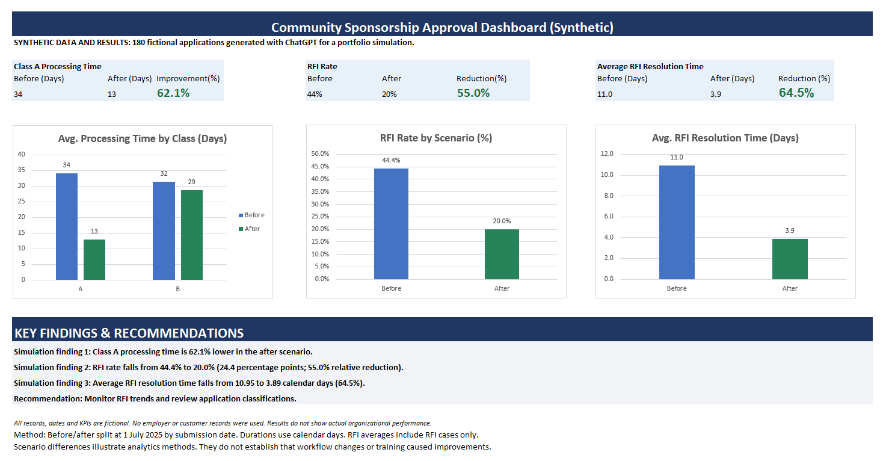

# Community Sponsorship Process Analytics

### Business Intelligence | Process Improvement | Data Visualization

**Tools:** Microsoft Excel, Power Query, PivotTables, Power BI, Tableau

**Project Type:** Synthetic business process analytics case study

## 1. Project Overview

This project analyzes a simulated community sponsorship application approval process to identify workflow bottlenecks, evaluate processing efficiency, and communicate operational performance through data visualization.

The business scenario is inspired by my professional experience in banking and financial services, including work at JPMorgan Chase.

All application records and performance results in this project are synthetic. No actual JPMorgan Chase application records or confidential business data were used.

## 2. Business Problem

Sponsorship applications move through multiple review and approval stages. Delays, requests for additional information (RFIs), and differences in application complexity can affect overall processing time.

The analysis addresses three business questions:

1. How does application processing time differ between two simulated scenarios?
2. How frequently do applications require additional information?
3. How much time is spent resolving RFIs?

## 3. Dataset

The dataset contains 180 fictional sponsorship applications generated for analytical practice.

- 90 applications in the Before scenario
- 90 applications in the After scenario
- Two application classifications: Class A and Class B
- Multiple workflow review stages
- Application dates and processing durations
- RFI indicators and resolution times

July 1, 2025 serves as the simulated scenario boundary.

The Before and After labels are used for comparison. They do not establish that any particular intervention caused the observed differences.

## 4. Analytical Methodology

### Data Preparation

Used Excel and Power Query to prepare and structure application-level data for analysis.

### KPI Development

Calculated and evaluated:

- End-to-end application processing time
- Average processing time by application class
- RFI rate
- Average RFI resolution time
- Before-versus-After scenario differences

### Analysis and Visualization

Used Excel PivotTables to summarize operational performance and created dashboard visualizations to communicate findings.

The project also includes Power BI and Tableau visualization work developed from the same analytical scenario.

## 5. Key Findings

The following results are from the synthetic dataset.

| KPI | Before | After | Change |
|---|---:|---:|---:|
| Class A average processing time | 34.13 days | 12.94 days | 62.1% reduction |
| RFI rate | 44.4% | 20.0% | 24.4 percentage-point decrease |
| Average RFI resolution time | 10.95 days | 3.89 days | 64.5% reduction |

The relative reduction in RFI rate is 55.0%.

Class B processing time also decreased, but the simulated improvement was considerably smaller than for Class A applications.

These differences illustrate how process analytics can help identify operational patterns and areas for further investigation.
### Excel Dashboard

## 6. Business Recommendations

Based on the simulated analysis:

1. Monitor processing times separately for Class A and Class B applications.
2. Track RFI frequency and resolution time as operational KPIs.
3. Investigate workflow stages associated with longer processing times.
4. Evaluate targeted training and process standardization opportunities.
5. Establish recurring dashboard reporting to monitor trends.

These recommendations are illustrative and would require validation against real operational data before implementation.

## 7. Project Deliverables

The project is designed to showcase:

- Excel data preparation and KPI analysis
- PivotTables and an operational dashboard
- Power BI dashboard
- Tableau dashboard
- Business findings and recommendations

Supporting files and dashboard screenshots will be added to this repository after validation.

## 8. Data Privacy and Disclaimer

**This is a synthetic case study.**

All 180 application records, dates, and reported performance metrics are fictional and were generated for analytical practice.

The project is inspired by professional business process experience but does not represent actual JPMorgan Chase operational results.

The scenario comparisons do not demonstrate a causal relationship between training, process changes, and performance improvement.

No confidential employer information or actual customer application records are intended for publication.

---

**Author:** Rooservelt Akume

**Portfolio:** https://r-akume.github.io/

**GitHub:** https://github.com/r-akume
